# Machine Learning & Data Science Internship Projects

Supervised machine learning projects built with Python, Pandas and Scikit-Learn during the
**Datheon Machine Learning & Data Science Internship**. Each task is a self-contained, fully executed
Jupyter notebook with evaluation metrics and charts.

| # | Task | Techniques | Notebook |
|---|------|-----------|----------|
| 1 | Multi-Class Benchmark Classification (Iris) | StandardScaler, 80/20 split, Logistic Regression, Decision Tree, confusion matrix, decision boundaries | [Iris_Classification.ipynb](task1_iris_classification/Iris_Classification.ipynb) |
| 2 | Real Estate Housing Price Prediction (California) | Imputation, one-hot encoding, feature engineering, VIF, OLS / Ridge / Lasso, GridSearchCV, residual analysis | [Housing_Price_Regression.ipynb](task2_housing_regression/Housing_Price_Regression.ipynb) |
| 3 | Predictive Customer Churn Classifier (Telco) | Data cleaning, one-hot encoding, SMOTE, class weighting, Random Forest, XGBoost, stratified CV, ROC-AUC, feature importance | [Customer_Churn_Classifier.ipynb](task3_customer_churn/Customer_Churn_Classifier.ipynb) |

---

## Task 1: Multi-Class Classification on the Iris Dataset

**Goal:** build an end-to-end classification pipeline that predicts the species of an iris flower
(*setosa*, *versicolor*, *virginica*) from four measurements, and benchmark two models.

### Pipeline

```
Iris dataset (150 rows, 4 features, 3 balanced classes)
        │
        ▼
Load into a Pandas DataFrame
        │
        ▼
EDA: summary stats, class balance, Seaborn pairplot, correlation heatmap
        │
        ▼
Stratified 80/20 train/test split  (120 train / 30 test)
        │
        ▼
StandardScaler (fitted on the training set only, to avoid data leakage)
        │
        ├──────────────────────────┐
        ▼                          ▼
LogisticRegression        DecisionTreeClassifier (max_depth=4)
        │                          │
        └────────────┬─────────────┘
                     ▼
Evaluation: accuracy, precision, recall, F1, classification reports,
confusion matrix heatmaps, feature importances, coefficients
                     │
                     ▼
Decision boundary plots (2 PCA components, and petal length vs. petal width)
```

### Results (test set, 30 samples)

| Model | Accuracy | Precision (macro) | Recall (macro) | F1-score (macro) |
|-------|---------:|------------------:|---------------:|-----------------:|
| Logistic Regression | 0.9333 | 0.9333 | 0.9333 | 0.9333 |
| Decision Tree       | 0.9333 | 0.9333 | 0.9333 | 0.9333 |

Both models classify every *setosa* correctly and make 2 errors each, both between *versicolor* and
*virginica*, the two species whose measurements overlap. Petal length and petal width are the most
informative features.


<details>
<summary>More charts</summary>


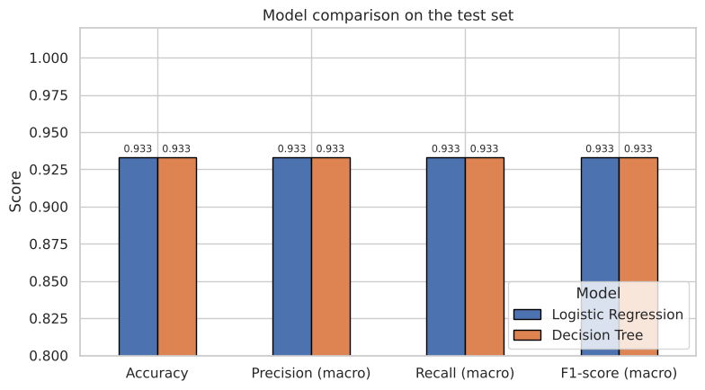

</details>

---

## Task 2: Real Estate Housing Price Prediction (OLS, Ridge & Lasso)

**Goal:** predict the median house value of California districts (1990 census, 20,640 rows) and compare
Ordinary Least Squares, Ridge (L2) and Lasso (L1) regression on RMSE, MAE and R².

**Dataset:** the California Housing CSV popularised by *Hands-On Machine Learning* (Géron), stored in
[`data/california_housing.csv`](data/california_housing.csv). It is used instead of scikit-learn's
`fetch_california_housing` because it keeps the real-world problems the task asks us to handle:
207 missing `total_bedrooms` values and a categorical `ocean_proximity` column.

### Pipeline

```
california_housing.csv (20,640 rows, 9 features + target)
        │
        ▼
EDA: missing values, target distribution (500k cap), geographic map, correlation heatmap
        │
        ▼
Feature engineering: rooms_per_household, bedrooms_per_room, population_per_household,
                     income_x_age (interaction), income_x_rooms (interaction)
        │
        ▼
Multicollinearity check with VIF → drop raw count columns and income_x_rooms (max VIF 49.9 → 9.2)
        │
        ▼
80/20 train/test split
        │
        ▼
ColumnTransformer inside a Pipeline (fitted on training folds only, no leakage)
  ├─ numeric:     SimpleImputer(median) → StandardScaler
  └─ categorical: OneHotEncoder(drop="first")
        │
        ├────────────────────┬──────────────────────────┐
        ▼                    ▼                          ▼
LinearRegression     Ridge + GridSearchCV       Lasso + GridSearchCV
   (OLS)            (30 alphas, 5-fold CV)     (30 alphas, 5-fold CV)
        │                    │                          │
        └────────────────────┴──────────────────────────┘
                             ▼
Evaluation: RMSE, MAE, R² · coefficient comparison · Lasso path
            predicted vs. actual plots · residual distribution curves
```

### Results (test set, 4,128 districts)

| Model | Best alpha | RMSE (USD) | MAE (USD) | R² |
|-------|-----------:|-----------:|----------:|---:|
| OLS (LinearRegression) | n/a | 71,931 | 51,221 | 0.6052 |
| Ridge (L2) | 1.27 | 71,942 | 51,230 | 0.6050 |
| Lasso (L1) | 7.88 | 71,941 | 51,230 | 0.6050 |

All three models explain about 60% of the variance in house prices and are within about 15 USD RMSE of each
other. With about 16,500 training rows and a compact, de-correlated feature set, OLS does not overfit, so
cross-validation picks small `alpha` values and regularisation adds almost nothing here. Median income and
location (inland vs. coastal) are the strongest predictors. The residual plots show where a linear model runs out
of room: prices are capped at 500,001 USD, and the errors grow as prices rise.

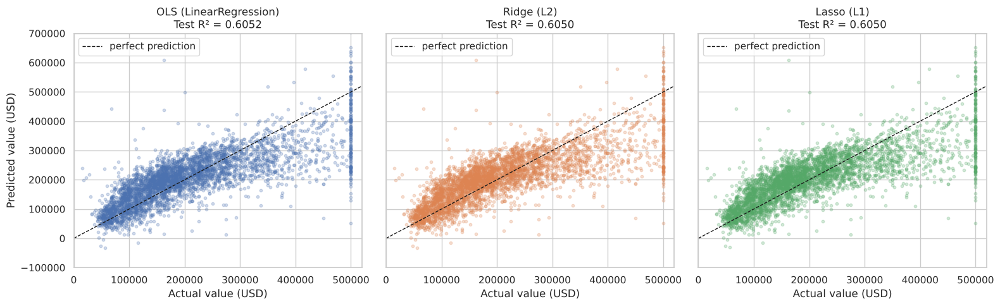

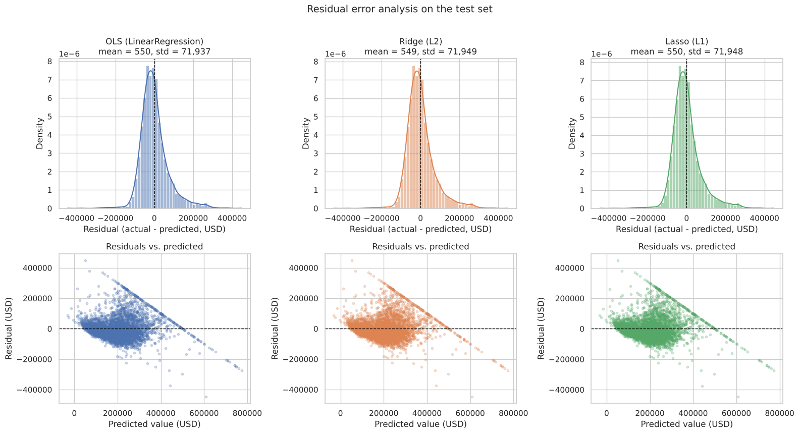

<details>
<summary>More charts</summary>

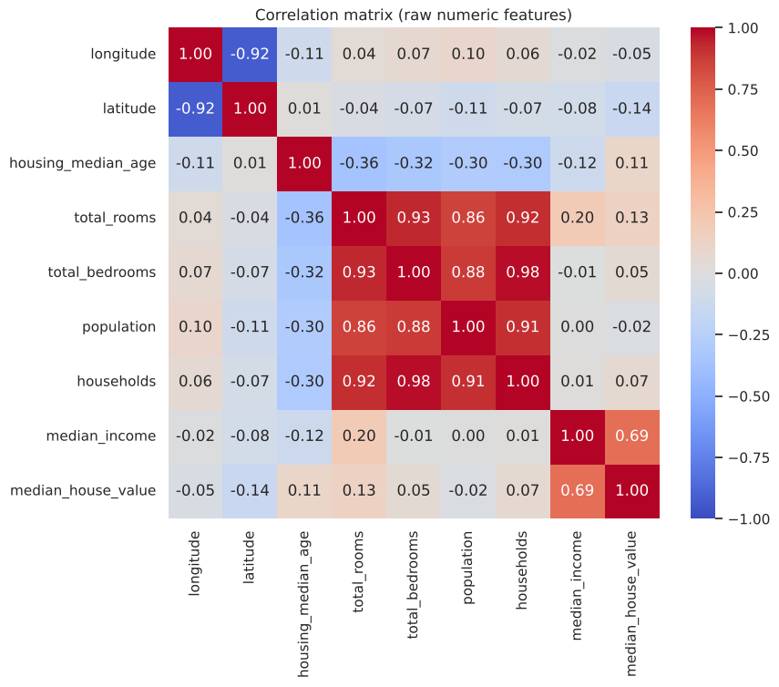

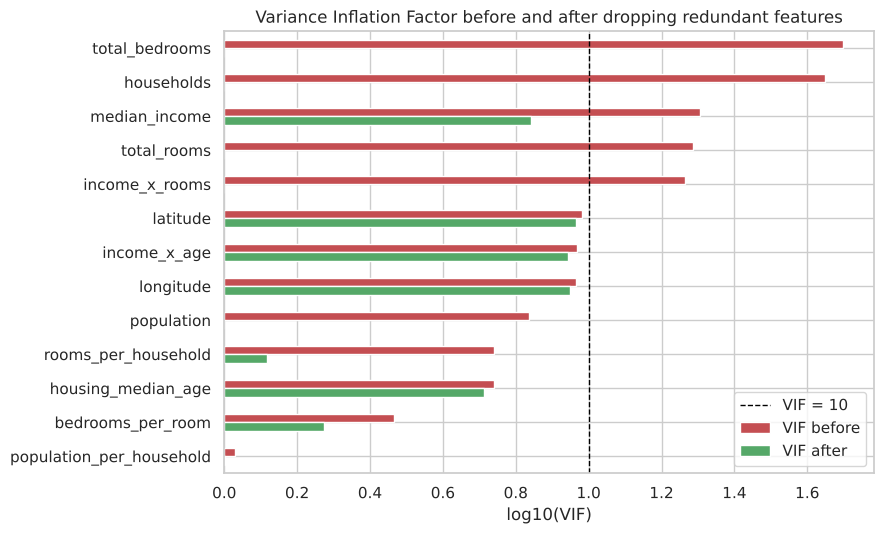

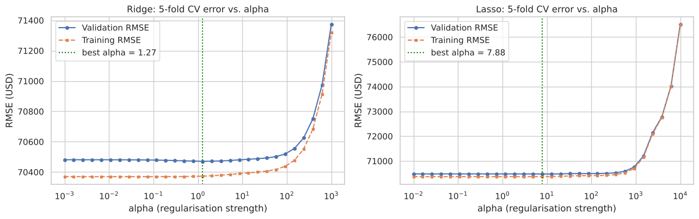

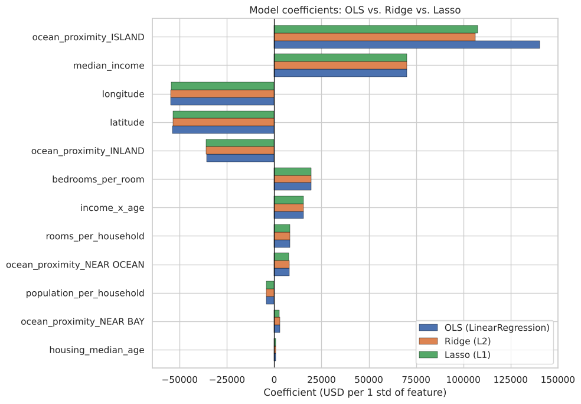

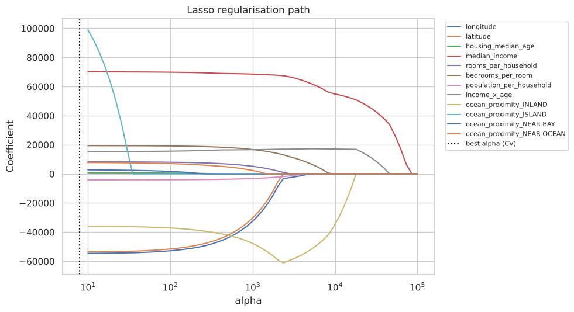

</details>

---

## Task 3: Predictive Customer Churn Classifier (Random Forest & XGBoost)

**Goal:** predict which telecom customers will cancel their subscription, handling a strong class imbalance
(26.5% churners) and reaching a **ROC-AUC above 0.80**.

**Dataset:** IBM Telco Customer Churn (7,043 customers, 21 columns), stored in
[`data/telco_customer_churn.csv`](data/telco_customer_churn.csv).

### Pipeline

```
telco_customer_churn.csv (7,043 rows, 26.5% churn)
        │
        ▼
Cleaning: TotalCharges text → numeric; 11 blanks are new customers (tenure 0) → 0; drop customerID
        │
        ▼
EDA: class imbalance, churn rate by contract / internet / payment / add-ons, tenure & charges distributions
        │
        ▼
Stratified 80/20 train/test split
        │
        ▼
ColumnTransformer: OneHotEncoder (15 categorical) + StandardScaler (4 numeric)
        │
        ├─────────────────────────────────┐
        ▼                                 ▼
imblearn Pipeline:                  imblearn Pipeline:
  SMOTE (training folds only)         XGBClassifier(scale_pos_weight ≈ 2.77)
  → RandomForestClassifier
        │                                 │
        ▼                                 ▼
GridSearchCV, 5-fold stratified CV, scored by ROC-AUC
        │                                 │
        └────────────────┬────────────────┘
                         ▼
Test evaluation: ROC-AUC, classification report, ROC curves,
confusion matrices, top 10 feature importances
```

### Results (test set, 1,409 customers)

| Model | Test ROC-AUC | CV ROC-AUC (5-fold) | Accuracy | Precision (churn) | Recall (churn) | F1 (churn) |
|-------|------------:|--------------------:|---------:|------------------:|---------------:|-----------:|
| Random Forest + SMOTE | **0.8376** | 0.8438 ± 0.0091 | 0.7630 | 0.5403 | 0.7166 | 0.6161 |
| XGBoost + scale_pos_weight | **0.8468** | 0.8493 ± 0.0113 | 0.7502 | 0.5191 | 0.7995 | 0.6295 |

Both models clear the 0.80 ROC-AUC target, and their cross-validation scores are close to their test scores.
XGBoost catches 80% of real churners (299 of 374). Both models rank a month-to-month contract and having no online
security as the strongest churn signals, followed by fiber optic internet, no tech support, payment by electronic
check and tenure.

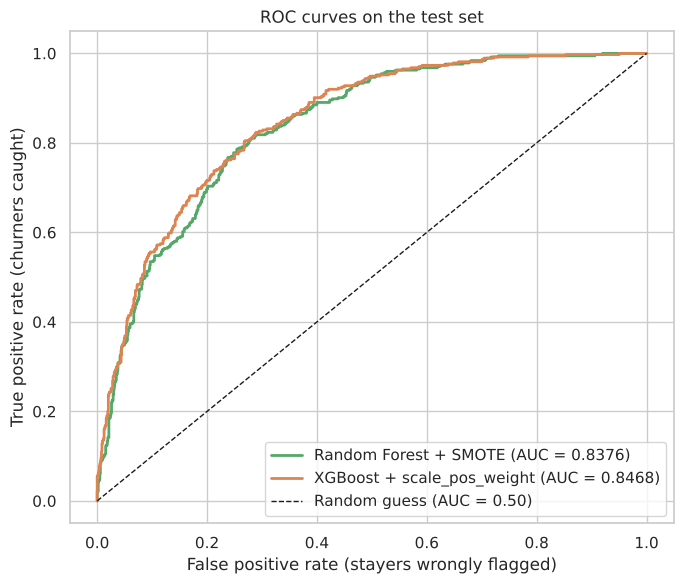

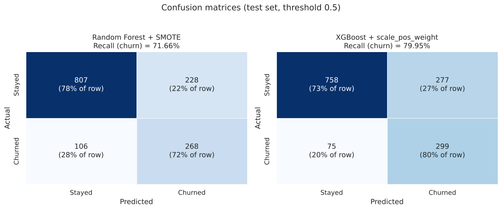

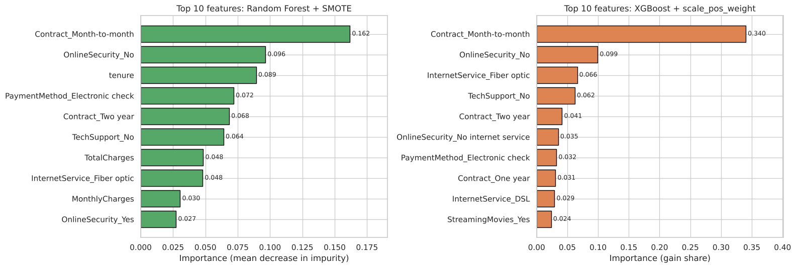

<details>
<summary>More charts</summary>

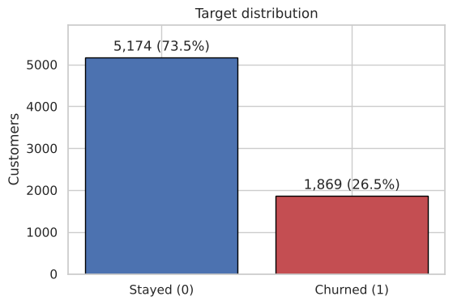

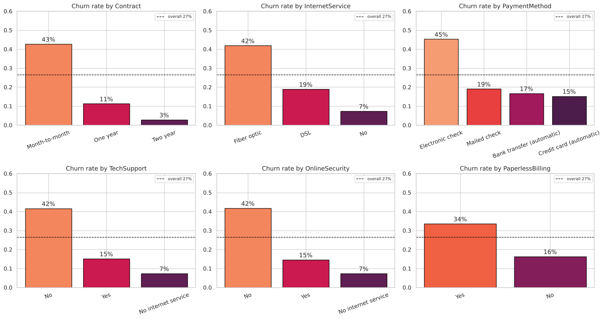

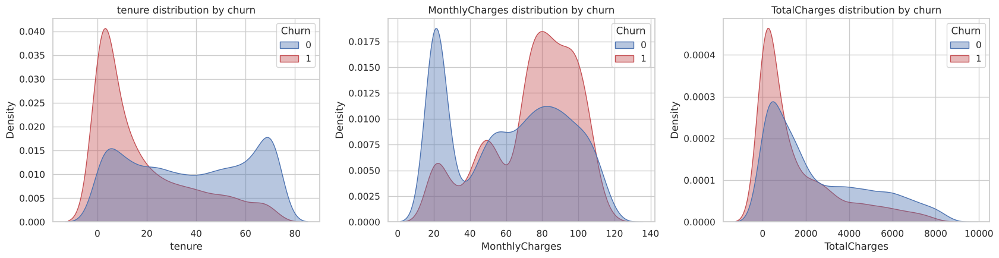

</details>

---

## Installation

Requires **Python 3.10 or newer**.

```bash
# 1. Clone the repository
git clone https://github.com/<your-username>/<repo-name>.git
cd <repo-name>

# 2. Create and activate a virtual environment
python -m venv .venv
# Windows:
.venv\Scripts\activate
# macOS / Linux:
source .venv/bin/activate

# 3. Install the dependencies
pip install -r requirements.txt

# 4. Launch Jupyter and open a notebook
jupyter notebook
```

The notebooks are saved with their outputs, so you can read them directly on GitHub without running anything.
To re-run one from scratch, use **Kernel → Restart & Run All**. Results are reproducible because every random
step uses `random_state=42`.

## Repository structure

```
.
├── README.md
├── requirements.txt
├── .gitignore
├── data/
│   ├── california_housing.csv          # Task 2 dataset
│   └── telco_customer_churn.csv        # Task 3 dataset
├── task1_iris_classification/
│   ├── Iris_Classification.ipynb       # executed notebook with all outputs
│   └── images/                         # charts exported for this README
├── task2_housing_regression/
│   ├── Housing_Price_Regression.ipynb  # executed notebook with all outputs
│   └── images/
└── task3_customer_churn/
    ├── Customer_Churn_Classifier.ipynb # executed notebook with all outputs
    └── images/
```

## Tech stack

Python · NumPy · Pandas · Scikit-Learn (Pipeline, ColumnTransformer, GridSearchCV) · imbalanced-learn (SMOTE) · XGBoost · Matplotlib · Seaborn · Jupyter
