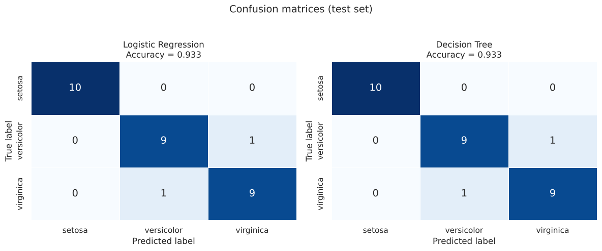
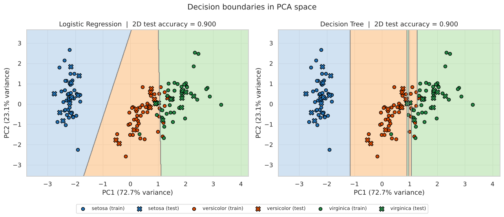
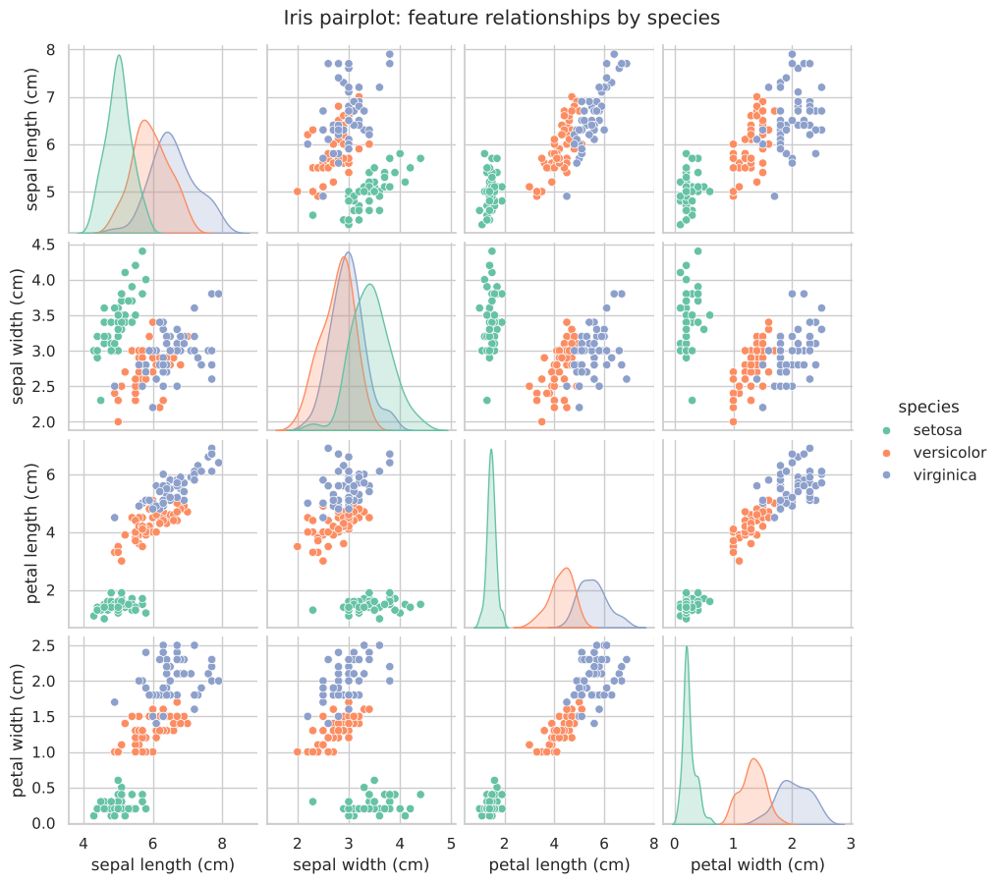

# Machine Learning & Data Science Internship Projects

Supervised machine learning projects built with Python, Pandas and Scikit-Learn during the
**Datheon Machine Learning & Data Science Internship**. Each task is a self-contained, fully executed
Jupyter notebook with evaluation metrics and charts.

| # | Task | Techniques | Notebook |
|---|------|-----------|----------|
| 1 | Multi-Class Benchmark Classification (Iris) | StandardScaler, 80/20 split, Logistic Regression, Decision Tree, confusion matrix, decision boundaries | [Iris_Classification.ipynb](task1_iris_classification/Iris_Classification.ipynb) |

---

## Task 1: Multi-Class Classification on the Iris Dataset

**Goal:** build an end-to-end classification pipeline that predicts the species of an iris flower
(*setosa*, *versicolor*, *virginica*) from four measurements, and benchmark two models.

### Pipeline

```
Iris dataset (150 rows, 4 features, 3 balanced classes)
        │
        ▼
Load into a Pandas DataFrame
        │
        ▼
EDA: summary stats, class balance, Seaborn pairplot, correlation heatmap
        │
        ▼
Stratified 80/20 train/test split  (120 train / 30 test)
        │
        ▼
StandardScaler (fitted on the training set only, to avoid data leakage)
        │
        ├──────────────────────────┐
        ▼                          ▼
LogisticRegression        DecisionTreeClassifier (max_depth=4)
        │                          │
        └────────────┬─────────────┘
                     ▼
Evaluation: accuracy, precision, recall, F1, classification reports,
confusion matrix heatmaps, feature importances, coefficients
                     │
                     ▼
Decision boundary plots (2 PCA components, and petal length vs. petal width)
```

### Results (test set, 30 samples)

| Model | Accuracy | Precision (macro) | Recall (macro) | F1-score (macro) |
|-------|---------:|------------------:|---------------:|-----------------:|
| Logistic Regression | 0.9333 | 0.9333 | 0.9333 | 0.9333 |
| Decision Tree       | 0.9333 | 0.9333 | 0.9333 | 0.9333 |

Both models classify every *setosa* correctly and make 2 errors each, both between *versicolor* and
*virginica*, the two species whose measurements overlap. Petal length and petal width are the most
informative features.





<details>
<summary>More charts</summary>




</details>

---

## Installation

Requires **Python 3.10 or newer**.

```bash
# 1. Clone the repository
git clone https://github.com/<your-username>/<repo-name>.git
cd <repo-name>

# 2. Create and activate a virtual environment
python -m venv .venv
# Windows:
.venv\Scripts\activate
# macOS / Linux:
source .venv/bin/activate

# 3. Install the dependencies
pip install -r requirements.txt

# 4. Launch Jupyter and open a notebook
jupyter notebook
```

The notebooks are saved with their outputs, so you can read them directly on GitHub without running anything.
To re-run one from scratch, use **Kernel → Restart & Run All**. Results are reproducible because every random
step uses `random_state=42`.

## Repository structure

```
.
├── README.md
├── requirements.txt
├── .gitignore
└── task1_iris_classification/
    ├── Iris_Classification.ipynb   # executed notebook with all outputs
    └── images/                     # charts exported for this README
```

## Tech stack

Python · NumPy · Pandas · Scikit-Learn · Matplotlib · Seaborn · Jupyter
